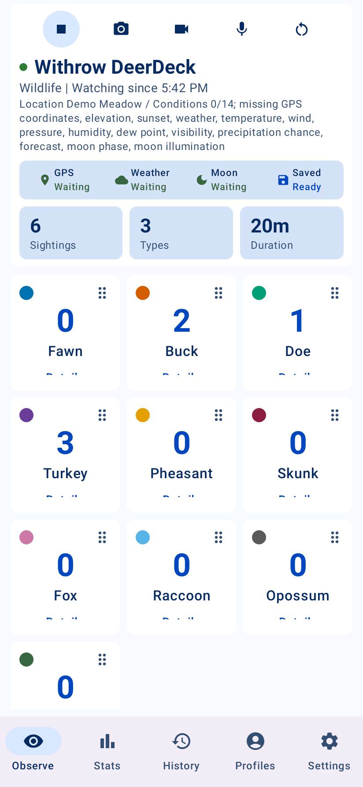
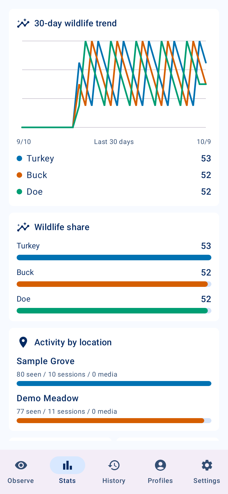
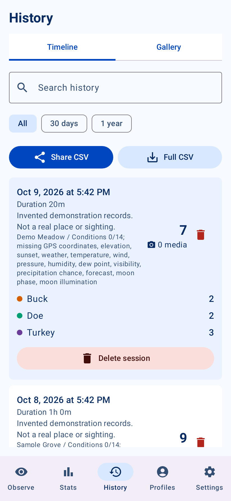
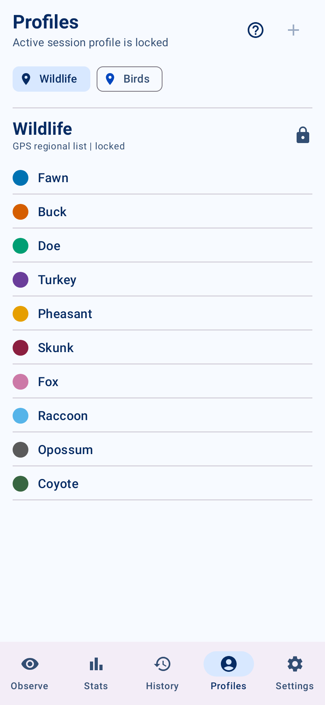

# Withrow DeerDeck

[](https://github.com/wildtwins/DeerDeck-public/actions/workflows/android-ci.yml)
[](LICENSE)
[](docs/try-preview.md)

**A local-first Android field journal for wildlife watching.** Count sightings
with a tap, keep notes and optional media, and explore patterns across your outings.
No DeerDeck account or server is required.

**[Download the 2.4.4 preview APK](https://github.com/wildtwins/DeerDeck-public/releases/tag/v2.4.4-preview.1)**
· [Installation and checksum](docs/try-preview.md)
· [Report an issue](https://github.com/wildtwins/DeerDeck-public/issues)

The preview is **debug-signed and CI-tested**. Physical-device and emulator tests
were unavailable; use a spare test device with disposable records. It is not a
Google Play release. Read the installation notes before trying it alongside an
existing DeerDeck installation.

## A field journal that stays under your control

- **Count quickly:** wildlife tiles, detailed observations, notes, and session tags.
- **Remember the outing:** optional photos, video, audio, GPS, and field conditions.
- **See patterns:** sighting trends, wildlife share, similar days, and Field IQ insights
  calculated from your own history.
- **Choose your list:** built-in Wildlife and Birds profiles, plus custom profiles.
- **Keep your data:** local history, searchable sessions, CSV/ZIP exports, and verified
  phone or user-selected Google Drive backups.

Observations stay on your device unless you choose export, sharing, or backup.
Android system backup may also preserve app data under your own device account.
Optional field conditions send session coordinates to NWS and USGS. No personal
records, credentials, or developer backup destination are included.

## See the app

These are **real app UI captures rendered on a host with Robolectric**, using
wholly fictional observations. They are not device screenshots or design mockups.
The downloadable app starts empty. [Capture method and limitations](docs/gallery/README.md).

| Observe and count | Explore statistics |
| --- | --- |
|  |  |
| **Review history** | **Choose profiles** |
|  |  |

<details>
<summary>17-second sample walkthrough</summary>

A slideshow of five actual host-rendered app states, including a count action;
this is not a device screen recording.


</details>

## Stack

- Kotlin 2.0.21 and Jetpack Compose
- Android Gradle Plugin 8.13.2 and Gradle 8.13
- Room local database
- CameraX photo/video capture
- WorkManager background scheduling
- `minSdk 26`, `targetSdk 36`
- GitHub Actions CI for tests, release lint, AAB, and debug APK artifacts

## Build and Validate

The source snapshot is version **2.4.4** (`versionCode 32`). Install JDK 17 and
an Android SDK with platform-tools, `platforms;android-36`, and
`build-tools;36.0.0`. Android Studio's SDK Manager or Android command-line tools
can install these packages. Accept the SDK licenses locally.

Set `JAVA_HOME` to your JDK and `ANDROID_HOME` to your SDK. Alternatively, copy
`local.properties.example` to `local.properties` and update `sdk.dir`. Do not
commit machine-specific configuration. Run all commands from the repository root.
Gradle downloads pinned build dependencies on the first run, so internet access
is needed to populate its cache.

Windows PowerShell:

```powershell
powershell -ExecutionPolicy Bypass -File .\scripts\validate.ps1
```

Linux or macOS with JDK 17 and Android SDK environment variables set:

```sh
chmod +x gradlew
./gradlew --no-daemon testDebugUnitTest lintDebug lintRelease assembleDebug bundleRelease assembleDebugAndroidTest
```

The Windows helper stores outputs under `.build-codex/app`; direct Gradle
commands use `app/build`. Unit tests and both lint variants must pass. The gate
also builds a debug APK, an unsigned release AAB, and the instrumentation test
APK. Building the test APK does not execute device tests.

No API key or server is required for the normal app. Optional weather requests
send the session coordinates to the U.S. National Weather Service and may be
unavailable outside its coverage area. Optional elevation lookup also sends coordinates to the USGS Elevation Point Query Service. The request User-Agent identifies the app
using the developer's public GitHub profile. Google Drive backups use Android's
document picker and the user's selected folder.

For manual installation and testing, use a test phone or emulator with disposable
records. `scripts/check-device.ps1` and `scripts/install-debug.ps1` are explicit
device actions, separate from validation. See [the smoke checklist](docs/beta-smoke-test.md).

## Source Privacy

This distribution excludes field records, camera captures, device screenshots,
backups, runtime databases, credentials, signing keys, local agent state, and
prior private Git history. The included UI gallery uses only fictional test records; launcher artwork and generated store
branding images are also included. See [publication notes](docs/publication.md).

## License

Released under the [MIT license](LICENSE). Third-party dependencies retain their
respective licenses.

## Google Play Release

The Play submission materials are under [`docs/play`](docs/play), and generated listing assets are under [`play-assets`](play-assets). Start with [`docs/play/release-checklist.md`](docs/play/release-checklist.md).

Create the private upload keystore once, then build a signed AAB:

```powershell
powershell -ExecutionPolicy Bypass -File .\scripts\create-upload-key.ps1
powershell -ExecutionPolicy Bypass -File .\scripts\build-play-release.ps1
```

The keystore and passwords are intentionally excluded from Git. Enroll the upload key in Play App Signing and preserve an encrypted offline recovery copy.

## Planned Later

- Continuous cloud synchronization and conflict resolution
- Opt-in wildlife photo identification
- Additional regional profile packs
